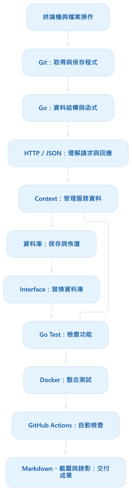

# Project 2 - Network Service Function
## 作業參考來源
- 作業參考來源：
  - [｛Project 2 - Network Service Function｝](https://cndi-free5gc.github.io/doc-project/pj2/)
  - [｛GitHub：cndi-free5gc / pj2-nsf｝](https://github.com/cndi-free5gc/pj2-nsf#readme)
  - [｛W 7 · 5 G C N E T WO R K F U N C T I O N ｝](https://cndi-free5gc.github.io/doc-slide/slides/W7%205GC%20Network%20Functions%20Other%20NFs.pdf)
- Prompt：作業說明
  - 請說明本次作業內容、重點及目標為何？
  - 我是初學者，我該如何完成作業規定內容，請詳細說明作業步驟為何及學習知識地圖？
  - 好的我的姓名：劉順松 | 學號：414551016，請操作我的電腦先幫我完成本次作業規定任務及目標，之後我再上傳到E3。

## 請說明本次作業內容、重點及目標為何？
本次 Project 2：Network Service Function（NSF），核心是：接手一個已有架構的 Go 專案，補完服務資料管理功能，讓服務可以被註冊、查詢及移除，再用測試證明實作正確。 網頁目前公告截止日期為 2026 年 11 月 9 日。[作業說明](#作業參考來源)

### 一、這個程式在做什麼？
可以把 NSF 想成「服務通訊錄」：記住誰提供什麼服務，以及要到哪個 IP、連接埠找它。
| 功能 | 白話說明 |
|---|---|
| Register／註冊 | 將提供者及其服務資料加入通訊錄 |
| Discovery／服務探索 | 按服務名稱查詢提供者與連線位置 |
| Group Discovery／群組探索 | 一次查詢多個服務 |
| Deregister／取消註冊 | 移除已登錄的服務 |
| Heartbeat／健康檢查 | 確認 NSF 本身能正常回應 |

這些功能及 API 已列在專案 README。[專案 README](https://github.com/cndi-free5gc/pj2-nsf#readme)

例如，以下是幫助理解的例子，不是指定測資：服務 A 登記自己位於 192.168.1.10:8000；其他程式詢問服務 A 在哪裡，NSF 就回傳這筆位置資訊。

### 二、你實際要完成什麼？
主要工作集中在兩個檔案：
| 檔案 | 要做什麼 | 為什麼做 |
|---|---|---|
| `internal/nsfContext/serviceContext.go` | 補完服務 Context 的 TODO，通過單元及整合測試 | 讓 NSF 正確管理服務資料與狀態 |
| `internal/db/customDb.go` | 實作可替換的資料庫介面 `dbIf` | 讓同一套服務邏輯能使用不同資料庫 |

Context 在這裡可以理解為「程式運作時保存的資料與狀態」。重點是讓新增、查詢、刪除及資料保存彼此一致。
Interface 則是「共同操作規則」。上層程式按照規則存取資料，不必知道底層使用哪一種資料庫。README 指定使用 Go 測試與提供的 Docker 測試映像驗證成果。[實作範圍與測試方式](https://github.com/cndi-free5gc/pj2-nsf#what-you-need-todo)

### 三、與 W7 講義有什麼關係？
講義第 8–9 頁介紹：
- Producer（生產者）：提供服務。
- Consumer（消費者）：使用服務。
- NRF（Network Repository Function）：讓服務提供者登錄，讓使用者查找。

流程是「提供者先登錄 → 使用者查詢 → 使用者取得位置後呼叫提供者」。本次 NSF 作業可以用這個概念理解，但 NSF 是作業專案名稱，不能直接視為完整的標準 NRF 實作。講義來源：[W7 5GC Network Functions Other NFs.pdf](https://cndi-free5gc.github.io/doc-slide/slides/W7%205GC%20Network%20Functions%20Other%20NFs.pdf)

### 四、學習目標與評分重點
作業希望你練習：閱讀既有程式、接續開發、Git/GitHub、GitHub Actions、Go 與單元測試、資料庫介面抽換、Docker 測試，以及 Markdown 報告。
| 項目 | 比重／要求 |
|---|---|
| 程式基本檢查 | `make lint`、`make`、`make test` 是必要門檻 |
| 基本功能測試 | 40% |
| 隱藏測試 | 30%，包含群組探索、NSF Recovery 等 |
| GitHub Actions | 20%，啟用且全部通過 |
| 資料庫介面抽換 | 10%，以螢幕錄影證明 |

測試部分只給 0%、40% 或 70%。因此，「能編譯」與「基本測試通過」都還不是全部完成。[評分規則](https://cndi-free5gc.github.io/doc-project/pj2/#評分)

### 五、最後要交什麼？
提交 <學號>.zip，內含：
- `Report.md`，務必放入正確的 GitHub 專案連結。
- `db.mp4`，展示資料庫抽換成功。
- 報告使用的圖片，確保可以正常顯示。

程式碼由助教從 GitHub 取得；連結遺漏或錯誤直接 0 分。另外，示範完自訂資料庫後，GitHub 最終設定的 db_Type 必須使用 bbolt，以配合助教測試環境。[繳交與設定要求](https://cndi-free5gc.github.io/doc-project/pj2/)

建議你依「讀懂註冊與查詢流程 → 補完 Context → 通過測試 → 完成資料庫抽換 → 整理證據與報告」的順序進行。這是我建議的實作順序；本次真正要培養的能力，是把陌生專案中的一個缺口補成可運作、可驗證、可交付的功能。

## 我是初學者，我該如何完成作業規定內容，請詳細說明作業步驟為何及學習知識地圖？
你可以把本次作業拆成 「看懂服務流程 → 補完資料管理 → 測試 → 抽換資料庫 → 繳交」 五件事。對初學者而言，最有效的方法是：每學一小段，就完成一個可以驗證的成果。
<br>以下「官方要求」依作業頁與 README 整理；學習順序、實作方法和驗收清單是我的建議。目前已核對這兩份來源，但未成功讀取個別程式檔，因此不會猜測實際函式名稱、Go 版本或 HTTP 回應碼。

### 一、先知道「做到什麼程度才算完成」
官方要求可以整理成這張清單：
| 項目 | 完成條件 |
|---|---|
| 個人專案 | Fork、Clone 作業 repository |
| 核心功能 | 完成指定 TODO |
| 基本品質 | `make lint`、`make`、`make test` 通過 |
| 功能測試 | 基本測試通過；準備群組探索、恢復等隱藏測試 |
| GitHub Actions | 已啟用，檢查全部通過 |
| DB Interface | 展示替換資料庫，錄成影片 |
| 最終設定 | GitHub 上的 `db_Type` 使用 `bbolt` |
| 繳交 | `<學號>.zip`，包含 `Report.md`、`db.mp4` 和報告圖片 |

評分為測試 70%、Actions 20%、資料庫抽換 10%；基本品質檢查是門檻。截止日目前為 2026/11/9。報告必須有正確 GitHub 連結，遺漏或錯誤會直接 0 分。[官方作業規定](https://cndi-free5gc.github.io/doc-project/pj2/)

### 二、學習知識地圖：你需要學哪些東西？
下面是建議的學習順序。先掌握前面的基礎，再往後完成整合。
<div align="left" >
    
  </div>

| 知識 | 白話解釋 | 本次學到什麼程度就夠 |
|---|---|---|
| 終端機 | 用指令操作檔案、執行程式 | 能切換目錄、讀檔、執行命令、看錯誤 |
| Git | 保存程式修改紀錄 | 會 `clone`、`status`、`diff`、`add`、`commit`、`push` |
| Go struct | 把相關資料放在一起 | 看懂一筆服務有哪些欄位 |
| Go slice／map | 清單／依鍵值查找的資料表 | 能新增、查詢、刪除資料 |
| 指標與方法 | 修改某個物件，以及物件提供的操作 | 看懂 `*Type` 和方法接收者 |
| error | 表達操作失敗的原因 | 會檢查及回傳錯誤 |
| HTTP／JSON | 程式彼此溝通的方式／資料格式 | 能讀懂請求內容和回應 |
| Context | 程式維護的資料及狀態 | 理解資料從建立到刪除的生命週期 |
| Database | 保存資料 | 理解記憶體資料與持久化資料的差別 |
| Interface | 一組共同的方法約定 | 能讓兩種資料庫提供相同操作 |
| Test | 自動檢查程式行為 | 能讀懂輸入、預期結果與失敗訊息 |
| CI | 每次推送後自動檢查 | 能看 Actions 執行結果與錯誤紀錄 |

補充一個容易混淆的觀念：Go interface 是介面型別，描述一組方法，不是 struct 本身。 某個型別實作了這些方法，就能滿足該介面。[Go 官方介面教材](https://go.dev/tour/methods/9)

### 三、階段 1：準備一個固定的開發環境
要做什麼： 選定一個環境，之後編輯、編譯、測試盡量都在同一處進行。
<br>以下指令以 `Ubuntu／WSL` 的 Bash 終端機 為例，不能原封不動當成 PowerShell 指令執行。這是操作示例，並不代表我已確認你目前環境可用。

先檢查：
```Bash
git --version
go version
make --version
docker version
```
為什麼做： 程式錯誤和工具未安裝是兩種不同問題，先排除工具問題，後面比較容易除錯。
| 結果 | 代表什麼 |
|---|---|
| 正常顯示版本 | 工具可以被找到 |
| `command not found` | 尚未安裝，或執行路徑未設定 |
| Docker 只有 Client，Server 出錯 | 指令存在，但 Docker 服務未連上 |
| Go 版本不符合專案 | 需依 `go.mod` 與 workflow 調整 |

成功條件： 四種工具都能使用；Go 與 lint 工具版本符合專案設定。
<br>先不要任意安裝「最新版」所有工具。取得專案後，查看 go.mod、Makefile 和 .github/workflows，再決定需要的版本。

### 四、階段 2：Fork、Clone，建立自己的作業副本
要做什麼：
1. 登入 GitHub。
2. 開啟 作業 repository。
3. 按 Fork，建立你帳號下的副本。
4. 到自己的副本，按 Code，複製 Clone URL。
5. 在 Ubuntu 終端機下載。
例如，先建立工作資料夾：
```Bash
mkdir -p ~/coursework
cd ~/coursework
```
再執行下面指令；請把 YOUR_ACCOUNT 換成自己的 GitHub 帳號：
```Bash
git clone https://github.com/YOUR_ACCOUNT/pj2-nsf.git
cd pj2-nsf
git remote -v
git status
```
為什麼做：
- Fork：在 GitHub 上建立你的版本。
- Clone：下載到電腦。
- Commit：保存一次修改紀錄。
- Push：將紀錄上傳 GitHub。

成功條件：
- git remote -v 指向你的 repository。
- git status 能正常顯示目前狀態。
- 目錄中能看到 README.md、go.mod、Makefile。
接著到你 repository 的 Actions 頁面，依畫面提示啟用 workflow。初始程式可能因 TODO 尚未完成而失敗；先記錄失敗原因，後續再修正。

### 五、階段 3：先讀懂「一筆資料怎麼走」，再修改程式
README 指定的主要實作位置為：
- internal/nsfContext/serviceContext.go
- internal/db/customDb.go

並指出 serviceContext_test.go 是核心功能的單元測試。README 實作說明

建議閱讀順序：
| 順序 | 看什麼 | 要回答的問題 |
|---|---|---|
| 1 | `README.md` | 系統提供哪些功能？ |
| 2 | `config.yaml` | 地址、連接埠、資料庫如何設定？ |
| 3 | `model` 內的資料型別 | 請求及回應包含哪些欄位？ |
| 4 | `serviceContext_test.go` | 測試期待什麼結果？ |
| 5 | `serviceContext.go` | 哪些地方尚未完成？ |
| 6 | `internal/db` | 如何寫入、讀取、刪除資料？ |
| 7 | `Makefile`、workflow | 如何建置與驗證？ |

可以搜尋：
```Bash
rg -n "TODO" .
rg -n "type .*interface" internal
rg -n "^func Test" internal
```
若沒有 rg，用編輯器的「整個專案搜尋」即可。

你此時應該能說明這條路徑：
外部送出請求 → API 解析資料 → Context 執行操作 → 資料庫保存或讀取 → API 回傳結果。

例如下面是教學用註冊資料，不是指定測資：
```JSON
{
  "nf_name": "demo-nf",
  "sbi_address": "127.0.0.1",
  "sbi_port": 9000,
  "services": ["demo-service"]
}
```
它表示：「demo-nf 在這個地址及連接埠提供 demo-service。」

先用紙筆寫出三個問題：
1. 註冊後，這筆資料放在哪裡？
2. 查詢 demo-service 時，怎麼找到它？
3. 取消註冊時，哪些資料需要一起移除？

這三題答得出來，再寫程式會容易很多。

### 六、階段 4：執行原始測試，建立修改前的紀錄
在專案根目錄執行：
```Bash
go mod download
make
make test
make lint
```
這些命令可能失敗，先看原因。
| 失敗類型 | 優先處理方向 |
|---|---|
| 下載套件失敗 | 網路、代理設定、套件來源 |
| 找不到 Go／lint 工具 | 安裝或路徑設定 |
| 編譯錯誤 | 語法、型別、缺少實作 |
| 測試結果不符合預期 | 功能邏輯 |
| lint 不通過 | 依錯誤位置修正品質問題 |

為什麼先測： 你需要知道哪些失敗原本就存在，才能判斷自己的修改是否有效。
<br>成功條件： 不要求此階段全部通過，而是你能把失敗分成「環境問題」與「未完成功能」。
<br>不要為了讓畫面變綠而刪除測試、跳過檢查或修改預期答案。

### 七、階段 5：補完 Context，一次完成一個行為
下面是建議實作順序，實際函式名稱和資料結構應以專案為準。
| 順序 | 要完成的行為 | 要確認的重點 |
|---|---|---|
| 1 | 初始化 | 容器、資料庫連線是否準備好 |
| 2 | 註冊 | 是否保存完整服務資料 |
| 3 | 單一服務查詢 | 是否找到正確提供者及位置 |
| 4 | 取消註冊 | 是否移除指定服務及相關紀錄 |
| 5 | 群組查詢 | 多個服務是否都有正確結果 |
| 6 | 恢復 | 重啟後是否能重建必要狀態 |

每次修改採用相同循環：
1. 找到對應的測試。
2. 讀懂測試建立了什麼資料。
3. 確認它檢查什麼結果。
4. 完成一小段功能。
5. 格式化並執行相關測試。
6. 通過後再處理下一項。

例如：
```Bash
gofmt -w internal/nsfContext/serviceContext.go
go test -v ./internal/nsfContext
```
也可以只執行某個測試；以下名稱是佔位文字，必須換成檔案裡的實際名稱：
```Bash
go test -v ./internal/nsfContext -run '^Test實際名稱$'
```
Go 的測試通常放在 _test.go，由 go test 執行。Go 官方測試教學
特別注意「記憶體」與「資料庫」的一致性。
例如：
- 記憶體有資料，但資料庫沒保存：執行中查得到，重啟可能消失。
- 資料庫有資料，但查詢用的索引未建立：資料存在，卻查不到。
- 只刪除其中一份：取消註冊後仍可能出現舊資料。

這些是理解 Context 的重點。

完成一個小階段後，保存紀錄：
```Bash
git diff
git status
git add internal/nsfContext/serviceContext.go
git commit -m "Implement service context management"
git push
```
若修改了其他檔案，先檢查差異，再加入對應檔案。

### 八、階段 6：用整個系統驗證功能
單元測試主要檢查程式內部；整合測試確認 API、Context、資料庫連在一起後是否正常。

先執行：
```Bash
make
make run
```
再開另一個終端機，使用專案提供的 nsf.postman_collection.json：
1. 在 Postman 匯入這個檔案。
2. 核對請求的地址、連接埠和目前設定。
3. 依 collection 的格式送出請求。
4. 檢查回應內容及程式執行紀錄。

不要只猜 HTTP 方法或 JSON 放置位置；以 collection 為準。

建議檢查這些情境：
| 情境 | 應觀察的結果 |
|---|---|
| 健康檢查 | NSF 正常回應 |
| 註冊後查詢 | 能找到剛才登錄的服務 |
| 取消註冊後再查詢 | 不再回傳已移除的資料 |
| 查詢未註冊服務 | 符合專案預期的未找到回應 |
| 群組查詢 | 回傳內容符合所查服務 |
| 停止並重啟 | 已保存資料能按設計恢復 |

官方明示會測查詢尚未註冊的服務，也列出 Group Discovery 和 NSF Recovery 等隱藏測試方向；精確回應請依測試與 Postman 檔確認。[測試資訊](https://cndi-free5gc.github.io/doc-project/pj2/#測試資訊)

接著執行官方 Docker 測試。在 Bash、專案根目錄 中：
```Bash
docker pull alonza0314/nsf-tester:latest
docker run --rm -v "$(pwd):/work" alonza0314/nsf-tester:latest
```
這是把 README 的「專案絕對路徑」改成目前目錄的寫法。[Docker 驗證方式](https://github.com/cndi-free5gc/pj2-nsf#docker-image-validate)

成功條件： 閱讀完整測試摘要，確認所需測項通過並留存截圖。容器能啟動、命令有執行，都不等於測試成功。

### 九、階段 7：完成資料庫介面抽換與錄影
先理解概念：
```
服務管理程式
      ↓ 呼叫共同介面
     dbIf
      ↓
bbolt 或另一種資料庫實作
```
要做什麼：
1. 找到 dbIf 定義。
2. 列出它要求的方法、參數和回傳值。
3. 閱讀現有 bbolt 實作。
4. 在指定位置實作另一種資料庫後端。
5. 依專案設定與初始化流程接入它。
6. 實際註冊資料，確認資料真的寫入該資料庫。

這一步的重點是：切換後，上層服務操作仍然成立。 單純改一個設定字串，不能證明抽換成功。

官方以 MongoDB 為示例，並要求螢幕錄影；MongoDB 是例子，並非網頁寫明的唯一選擇。[DB Interface 評分說明](https://cndi-free5gc.github.io/doc-project/pj2/#評分)

建議影片依序展示：
1. 設定目前使用哪個資料庫。
2. 啟動 NSF。
3. 註冊一筆容易辨識的服務。
4. 在資料庫自己的查詢工具中找到該筆資料。
5. 透過 NSF 查詢服務，顯示結果。

錄影前先演練一次，確保文字可讀、操作連續。
完成示範後，把最終設定恢復成 bbolt，重新測試，再推送 GitHub。

### 十、階段 8：完成 Actions 與提交前驗證
在 GitHub 的 Actions 頁面，查看最後一次提交的執行結果。
若失敗：
1. 點開失敗的執行紀錄。
2. 找出第一個真正出錯的步驟。
3. 判斷是工具版本、編譯、測試或 lint 問題。
4. 修正後重新推送。
5. 確認新的執行結果通過。

常見情況包括
| 現象 | 常見原因 |
|---|---|
| 本機通過，GitHub 失敗 | 檔案漏推送、版本差異、依賴本機環境 |
| GitHub 找不到檔案 | 大小寫不同、路徑寫死 |
| 重啟後資料不見 | 未持久化，或啟動時未載入 |
| 註冊成功但查不到 | 保存資料與查詢使用的鍵值不一致 |

建議最後做一次「全新下載驗證」：
將你的 GitHub 專案 Clone 到新的目錄，重新執行檢查與測試。這能確認成果不依賴原本目錄裡未提交的檔案或舊資料。

### 十一、階段 9：整理報告、影片與壓縮檔
以下是我建議的報告內容，不是官方另行公布的必填章節模板：
| 報告內容 | 要交代什麼 |
|---|---|
| 基本資料 | 姓名、學號、GitHub repository 連結 |
| 實作說明 | 完成哪些功能、資料如何管理 |
| 資料庫抽換 | 使用哪種後端、如何接上共同介面 |
| 測試證據 | 本機檢查、Docker、Actions 的結果 |
| 問題與處理 | 遇到什麼問題、怎麼確認原因 |
| 尚有限制 | 未通過或未驗證的項目，誠實標示 |

整理成：
```
學號.zip
├── Report.md
├── db.mp4
└── images/
    ├── local-tests.png
    └── actions.png
```
壓縮後再解壓到另一個目錄檢查：
- 根目錄直接看得到 Report.md、db.mp4。
- GitHub 連結正確且助教能存取。
- 圖片正常顯示。
- 影片可以播放。
- GitHub 上是最終程式及 bbolt 設定。
- 最後依課程指定入口上傳，確認有提交成功紀錄。

準備好壓縮檔與完成上傳，是兩個分開的完成條件。

### 十二、建議時間分配與你現在的第一步
以下是建議安排，可依你的進度調整：
| 時段 | 工作 | 當天應有的成果 |
|---|---|---|
| 第 1–2 天 | 環境、Fork、Clone、讀 README | 能執行工具及原始測試 |
| 第 3–4 天 | Go 基礎、資料流與測試閱讀 | 能說明註冊和查詢流程 |
| 第 5–8 天 | Context 實作 | 相關單元測試逐步通過 |
| 第 9–10 天 | API、群組查詢與恢復驗證 | 整合測試結果 |
| 第 11–13 天 | 資料庫抽換 | 可重現的示範 |
| 第 14–15 天 | Actions、全新下載測試 | 最終提交驗證通過 |
| 剩餘時間 | 錄影、報告、打包及上傳 | 完整提交紀錄 |

你現在先完成三件事就好：
1. 確認 Git、Go、Make、Docker 是否可用。
2. Fork 並 Clone 自己的 repository。
3. 執行原始 make test，保留完整輸出。

第一個里程碑是：「我能取得專案、執行測試，而且知道失敗發生在哪裡。」 做到這一步，再開始補第一個 TODO。

## 好的我的姓名：劉順松 | 學號：414551016，請操作我的電腦先幫我完成本次作業規定任務及目標，之後我再上傳到E3。
- 建立我的 [GitHub fork](https://github.com/414551016/pj2-nsf)。
- 在本機實作服務註冊、查詢、取消註冊與 MongoDB 資料庫介面。
- 第一輪編譯、單元測試及 lint 通過。
- 新增的重啟恢復、部分取消註冊、並行操作與競態檢查通過。


