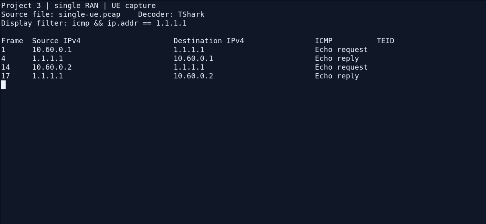
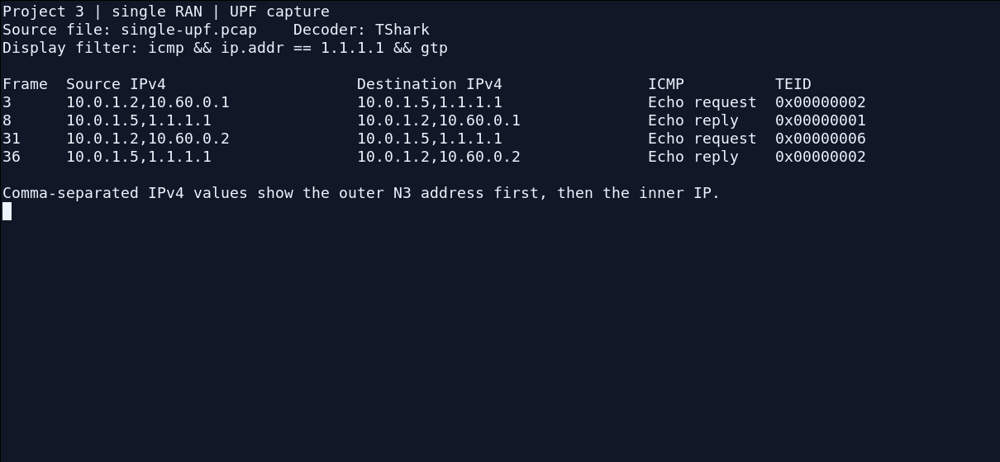
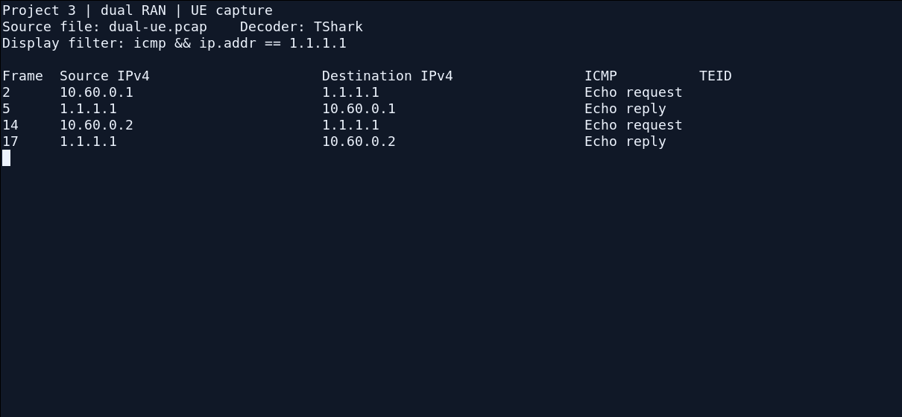
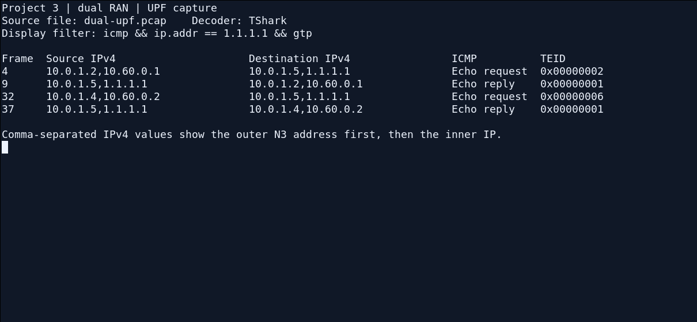

# Project 3 — NR Dual Connection

劉順松｜414551016

程式庫：[414551016/pj3-dc](https://github.com/414551016/pj3-dc)
提交版本：[8333e13](https://github.com/414551016/pj3-dc/commit/8333e13df1629cd9a27d2c8f624d5c75fa1e8e13)

## 1. 單 RAN 雙 PDU Session 的建立方式

UE 先經 Master gNB 完成一次註冊，然後用同一條控制面連線依序送出 PDU Session ID 4 與 5 的 NAS 建立請求。兩次 NAS Accept 的 IPv4 資訊分別保存。UE 以 `ueTun0` 對應 Session 4，以 `ueTun1` 對應 Session 5。

當 `staticNrdc` 和 `nrdc.enable` 都為 `false`，UE 以 Master 的 `10.0.2.3:31414` 送收 Session 4，並以 `10.0.2.3:31416` 送收 Session 5。Master 依 NGAP Request 裡的 Session ID 設定資源，為第二條 Session 配置獨立下行 TEID。上行按 UE 的 UDP 端點選擇 Session 與上行 TEID，下行按 TEID 選擇 UE 的 UDP 端點。NGAP Setup Response 回填對應的 Session ID 與下行端點。

## 2. 單 RAN 的封包證據

以兩個介面分別 ping `1.1.1.1`。表中的編號來自各自的 pcap，依序列出 Echo Request／Reply。UPF 圖中的逗號左側是 GTP-U 外層 N3 IP，右側是內層 IP。

| UE 介面 | 內層 UE IPv4 | UE 封包編號 | UPF 封包編號 | N3 承載端點 |
| --- | --- | --- | --- | --- |
| `ueTun0` | `10.60.0.1` | 1／4 | 3／8 | Master `10.0.1.2` |
| `ueTun1` | `10.60.0.2` | 14／17 | 31／36 | Master `10.0.1.2` |

## 3. 雙 RAN 雙 PDU Session 的建立方式

當 `staticNrdc` 和 `nrdc.enable` 都為 `true`，Session 4 仍由 Master gNB 承載。Master 只把 Session 5 的 NGAP 資源建立資訊經 Xn 傳給 Secondary。Secondary 保存 Session 5 的上行 TEID、配置自己的下行 TEID，並把對應的 N3 位址與 TEID 回給 Master。Master 把這組端點寫進 Session 5 的 NGAP Setup Response，使 UPF 將 Session 5 的下行流量送往 Secondary gNB。

UE 的 `ueTun0` 繼續用 `10.0.2.3:31414`。其 `ueTun1` 則依 `nrdc.dcRanDataPlane` 連到 Secondary 的 `10.0.2.4:31414`。兩條 Session 的資料面按 TUN 介面分流。N3 的 Master、Secondary 和 UPF 位址分別是 `10.0.1.2`、`10.0.1.4`、`10.0.1.5`。

## 4. 雙 RAN 的封包證據

以兩個介面分別 ping `1.1.1.1`。表中的編號來自各自的 pcap，依序列出 Echo Request／Reply。UPF 圖中的逗號左側是 GTP-U 外層 N3 IP，右側是內層 IP。

| UE 介面 | 內層 UE IPv4 | UE 封包編號 | UPF 封包編號 | N3 承載端點 |
| --- | --- | --- | --- | --- |
| `ueTun0` | `10.60.0.1` | 2／5 | 4／9 | Master `10.0.1.2` |
| `ueTun1` | `10.60.0.2` | 14／17 | 32／37 | Secondary `10.0.1.4` |

## 重現方式

在 Linux 上用作業提供的 Compose、配置及 subscriber 資料執行 `cd test && bash grade.sh`。腳本會切換兩種模式，在兩條 TUN 分別 ping `1.1.1.1`。UE 端以內層來源與回覆 IP 判定每條 Session 的收送。UPF 端展開 GTP-U，比對外層 N3 端點和內層 UE IP。

本機已通過 `make build`、`make test`、`make lint`（0 issues）與 `make image`。GitHub Actions 的 [Commit Message Check](https://github.com/414551016/pj3-dc/actions/runs/43907632822)、[Go](https://github.com/414551016/pj3-dc/actions/runs/43907632669) 及 [GolangCI-Lint](https://github.com/414551016/pj3-dc/actions/runs/43907632838) 均成功。

官方本機評分腳本結果為 **80/80**。單 RAN 60/60，雙 RAN 20/20。
